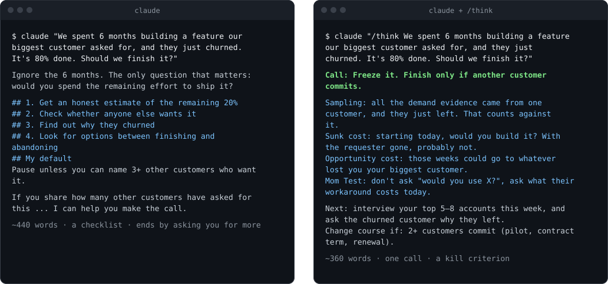

<h1 align="center">think</h1>

<p align="center"><b>Mental models that end in a decision, not a lecture.</b><br/>
A Claude Code skill: picks the 3–5 of ~50 models that fit <i>your</i> situation, runs each one,
and connects them into one call, one next step and a kill criterion.</p>

<p align="center">
  <a href="LICENSE"></a>
  
  
  
</p>

<p align="center">
  <a href="#install">Install</a> &ensp;·&ensp;
  <a href="#what-you-get">Example</a> &ensp;·&ensp;
  <a href="#how-it-works">How it works</a> &ensp;·&ensp;
  <a href="#the-models">The models</a> &ensp;·&ensp;
  <a href="#find-more-skills-like-this">More skills</a>
</p>

<p align="center">
  
  <br/><sub>Same model, same question, clean sessions. <a href="examples/plain-vs-think.md">Full transcripts</a>.</sub>
</p>

```bash
claude plugin marketplace add akshit9162/think && claude plugin install think@think
```

Then:

```
/think should I take contract work at $70/hr or keep the hours for my startup?
```

> Looking for skills like this for the rest of your work? **[skillscout](https://github.com/akshit9162/skillscout)**
> indexes every public agent skill weekly (32,000+) and recommends the ones that fit what you
> actually do. Scanned before install, pinned to a commit.

---

## Why

Ask an AI "should I do X or Y?" and you usually get a balanced pros-and-cons list that ends in
"it depends on your priorities." Mental-model skills mostly make it worse: they define
inversion and first principles at you.

`think` is built around one idea from the people who use these models seriously: **stop
collecting concepts, start connecting them.** The output is not a tour of frameworks. It is a
recommendation, the one action to take next, and the signal that should make you change
course.

## What you get

**Default — short (≈200 words):**

```
/think should I take contract work at $70/hr or keep the hours for my startup?
```

> **Call:** Take it, capped at 8–10 hrs/week and stopped when you've banked your launch budget.
> Take the hours from polishing, never from selling.
>
> **Why:**
> - **Opportunity cost:** the hours would come from coding time, which is already going to
>   redesigns, not from the customer work that's actually stuck.
> - **Margin of safety:** at ~₹6,160/hr, ~20 hours covers the launch floor, so the biggest
>   outside risk goes away without equity or grants.
> - **Barbell:** you have two risky bets and no safe side; capped paid work is the safe side.
>   25 hrs/week is the "moderate middle" that kills both.
> - **Tension:** your rule says attention is the scarce resource; the cap and the target
>   resolve it.
>
> **Next:** apply this week. **Change course if:** the real rate is far below $70/hr, or
> contract hours start eating selling time.

**Deep — `/think deep …`:** per-model sections (*what it asks · applied · non-obvious
insight*), a long "connecting them" section on where the models agree and which wins, then the
call. Used automatically for high-stakes, irreversible decisions.

More real outputs in [`examples/`](examples/), including the [full plain-vs-think transcripts](examples/plain-vs-think.md).

## How it works

1. **Reads your context first.** If the problem touches a project you keep notes on
   (`CLAUDE.md`, memory files, a wiki, a README), it reads them. Specifics are what make the
   answer useful; this matters more than the models.
2. **Picks 3–5 models from different groups**, preferring ones that pull against each other
   (optionality vs. opportunity cost, sunk cost vs. margin of safety). The tension is where
   the insight is.
3. **Runs the real steps.** 26 models ship as full files with sources, **When to Avoid**,
   **Thinking Steps** and **Coaching Questions**. The skill walks the steps against your facts
   and drops a model when its "when to avoid" applies.
4. **Connects and commits.** Where the models agree, where they conflict, which wins and why,
   then one call, one next step and a kill/pivot criterion.

Claude reads a model file only when it picks that model, so a 50-model library costs about
the same as a 5-model one.

### Modes

| Ask | You get |
|---|---|
| `/think <question>` | Short call + one line per model + next step |
| `/think deep <question>` | Full per-model breakdown |
| `premortem this: <plan>` | Failure-mode table (probability · severity · mitigation · trigger) |
| "is there demand for …" | Mom Test interview questions + what counts as a real commitment |
| "how much should I bet / invest …" | Expected value & Kelly arithmetic with a margin of safety |

It also triggers on "think this through", "first-principles this", "invert this", "what am I
missing" and "should I keep going or quit". For a multi-advisor debate on a big decision, use a
council-style skill instead; `think` is the single structured pass.

## The models

~50 models in five groups ([full index](skills/think/models/index.md)). **Bold** = deep file
with sources and thinking steps.

| Group | Models |
|---|---|
| Thinking about thinking | **First principles**, **Inversion**, **Premortem**, **Second-order thinking**, **Circle of competence**, **Framing**, Metacognition, Dunning–Kruger, Map ≠ territory, Occam's razor, Thought experiment |
| Biases & evidence | **Confirmation bias**, **Bias from incentives**, **Social proof**, **Sunk cost fallacy**, **Sampling**, **Randomness**, **Regression to the mean**, **The Mom Test**, Availability heuristic, Hanlon's razor, Chesterton's fence |
| Learning & performance | **Activation energy**, **Inertia**, **Scarcity**, Deliberate practice, Flow, Spaced repetition, Feynman technique, Identity shifting |
| Growth & strategy | **Opportunity cost / trade-offs**, **Leverage**, **Bottlenecks**, **Asymmetric warfare**, **Creative destruction**, Pareto 80/20, Compounding, Skill stacking / T-shaped, Network effects, Regret minimization |
| Risk & systems | **Margin of safety**, **Expected value & Kelly**, **Feedback loops**, **Emergence**, Probabilistic thinking, Antifragility, Optionality, Barbell strategy, Systems thinking |

### Add your own

Drop a file in the same shape into `~/.claude/mental-models/` (personal) or `.mental-models/`
(per project). Your model wins a name clash with a bundled one. Format: copy any file in
[`skills/think/models/`](skills/think/models/) — frontmatter, then *When to Avoid*, *Thinking
Steps*, *Coaching Questions*.

## Install

**Plugin (recommended):**

```bash
claude plugin marketplace add akshit9162/think
claude plugin install think@think
```

**Manual:**

```bash
git clone https://github.com/akshit9162/think
cp -R think/skills/think ~/.claude/skills/think
```

Works with any agent that reads `SKILL.md` folders.

## Find more skills like this

`think` is one skill. **[skillscout](https://github.com/akshit9162/skillscout)** finds the rest:

- a weekly index of every public agent skill it can find (32,000+ from 1,100+ repos)
- scored on your machine against each kind of work you do, with a Claude Code agent per persona
- every skill scanned before install and pinned to a commit, with upstream diffs when it changes

```bash
claude plugin marketplace add akshit9162/skillscout && claude plugin install skillscout@skillscout
```

## Credits

Built on the shoulders of three MIT-licensed projects, with thanks:
[cyperx84/claude-skills-mental-models](https://github.com/cyperx84/claude-skills-mental-models)
(21 sourced model files), [deciqAI/knowledge-skills](https://github.com/deciqAI/knowledge-skills)
(premortem, sunk cost, circle of competence, expected value & Kelly, the Mom Test) and
[decision-mental-models](https://github.com/ndesv21/openclaw-master-skills/tree/main/skills/decision-mental-models) by arbazex (the
*what it asks / applied / insight* format and several quick models). Details and licence texts
in [CREDITS.md](skills/think/CREDITS.md).

If `think` changed a decision for you, a ⭐ helps other people find it.
